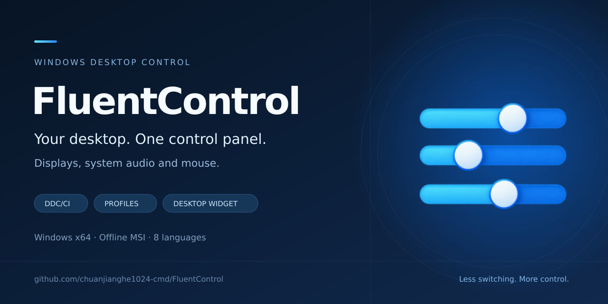

# FluentControl · 聚合控制

**多屏、声音、麦克风与鼠标，一个面板就够。**  
**Your displays, audio, microphone and mouse — in one panel.**

Windows 11 风格 · Windows x64 · 离线 Setup / MSI 安装 · 8 种界面语言

[简体中文](#zh-cn) · [English](#en) · [下载 / Download](https://github.com/chuanjianghe1024-cmd/FluentControl/releases/latest) · [使用手册 / Wiki](https://github.com/chuanjianghe1024-cmd/FluentControl/wiki) · [更新记录 / Changelog](CHANGELOG.md) · [配套硬件 / Hardware](https://github.com/chuanjianghe1024-cmd/fc-sensor-models) · [FCSD 驱动 / Drivers](https://github.com/chuanjianghe1024-cmd/FCS-Drivers) · [反馈 / Issues](https://github.com/chuanjianghe1024-cmd/FluentControl/issues)

## 让桌面设备跟上你的使用场景

FluentControl 是一款面向 Windows 的 **DDC/CI 显示器亮度与多屏控制工具**，同时提供系统音量、输入和鼠标调节。把分散在显示器实体按键、系统声音设置和鼠标设置中的常用操作，放进统一的 Fluent 风格界面。

从办公切换到游戏、从白天切换到夜间，保存一套配置后就能再次调用。多台显示器可以一起调，也可以分别调；常用控制还能留在桌面上，减少反复打开窗口和寻找菜单的操作。

### 它解决什么问题

| 你遇到的情况 | FluentControl 的做法 |
| --- | --- |
| 多块屏幕亮度不同，逐台按按钮很麻烦 | 整体或单独调节，并为每屏设置亮度映射 |
| 办公、游戏、夜间需要重复调整设备 | 保存显示器、声音、麦克风和鼠标的总配置，随时切换 |
| 好用的显示器参数难以整理、迁移和复用 | 按型号管理预设，支持批量导入、导出与兼容性检查 |
| 常用控制分散在多个系统窗口 | 用主面板、托盘、快捷键和半透明桌面面板快速操作 |

### 主要功能

- **显示器控制**：在硬件支持时调节亮度、对比度、色温预设、RGB、Gamma、饱和度、显示模式、输入源和屏幕音量等。
- **系统色温与 HDR**：每屏独立调整 SDR 画面冷暖、恢复原颜色，并按 Windows 能力切换 HDR；HDR 下明确提示亮度、对比度等可能受限。
- **跨型号多屏联动**：不同型号也能整体调节；只向支持对应功能和选项的屏幕发送设置，并标明部分支持的情况。
- **总配置与型号预设**：总配置保存整套设备状态，型号预设保存可复用的单屏参数。更新时保留离线设备参数，修改库中预设不会悄悄改变已有总配置。
- **声音、麦克风与鼠标**：调节声音和输入的音量与静音、鼠标速度和指针大小。音频简化为「音量」「输入」两项，自动跟随 Windows 当前默认选择；虚拟声卡同样通过系统控制，不需要在 FC 中重新选择或绑定。
- **桌面面板与快捷操作**：半透明、可移动和缩放；双击立即解锁并前置，失焦或 Esc 锁定；支持 Win+D 显示桌面、托盘驻留和全局快捷键。
- **每屏软件菜单与诊断**：通过 FC 屏幕菜单集中调节当前屏幕，采集只读诊断信息，为具体型号适配提供依据。
- **手动更新与分类设置**：设置按常规、显示器、快捷键、桌面面板、准星、关于与更新分类；主动检查 GitHub 正式版，下载校验后自行选择安装。
- **离线使用与多语言**：本地配置和 JSON 分享文件无需在线账户；支持简体中文、繁體中文、English、日本語、한국어、Deutsch、Français、Español。

### 下载与开始使用

**v0.3.140 新增 USB 设备管理、C3 配网参考程序与认证 Wi-Fi 光照订阅**，并提供跟随应用主题的 Fluent 托盘菜单。包含 Windows WMI 内屏亮度与自动调节；实体传感器联动和笔记本仍需实测。提供 Windows x64 离线 Setup.exe 与 MSI。

**[下载新版 Setup（推荐）](https://github.com/chuanjianghe1024-cmd/FluentControl/releases/download/v0.3.140/FluentControl-0.3.140-x64-Setup.exe)** · [MSI / 校验文件](https://github.com/chuanjianghe1024-cmd/FluentControl/releases/latest) · **v0.3.140** · [版本说明](docs/releases/v0.3.140.md)

1. 下载并运行 Setup。新安装可选择有写入权限的本地目录，并决定是否随 Windows 启动；成功后点击“启动 FluentControl”。支持离线安装，无需管理员权限，单独 MSI 也继续提供。升级沿用原目录；迁移目录时先卸载再安装，个人配置保留。
2. 在外接显示器的实体菜单中开启 **DDC/CI**，连接后读取设备。
3. 为屏幕命名，选择整体或单独控制，保存第一套配置。
4. 按需开启桌面面板、快捷键和开机自启动。

主要面向 **Windows 11 x64**。升级前请从托盘彻底退出旧版本；升级和卸载均保留个人配置。当前正式安装包未做代码签名，Windows 可能显示“发布者未知”。开发分支的后续修复见 [更新记录](CHANGELOG.md)，测试安装包见 [Windows build](https://github.com/chuanjianghe1024-cmd/FluentControl/actions/workflows/build.yml)。

### 兼容性与当前进展

**v0.3.92 新增系统色温（软件）**：按屏调整画面冷暖，一键恢复原曲线，可保存到本机总配置；适用于接口可用的 SDR 内屏或外屏。HDR/自动颜色管理下暂不使用此兼容接口，提供 Windows 夜间模式入口。[范围与使用说明](docs/system-color-temperature.md)。

**v0.3.92 新增每屏 Windows HDR 开关**：切换后重新检测显示器控制项；与 DDC/CI 独立，Windows 支持 HDR 的内屏也可使用。WMI 笔记本亮度与厂商专有功能尚未接入，实体屏幕切换待本机验证。[控制范围与使用说明](docs/windows-hdr.md)。

显示器可用功能取决于型号、固件、连接方式和当前模式。HDR、节能模式、转接器及扩展坞可能限制调节；带有音频输出也不一定支持显示器硬件音量遥控。FC 软件菜单已提供，**直接打开和导航显示器原厂 OSD 仍需经过验证的型号适配**。v0.3.92 提供实验性的[本地 OSD 配对助手](docs/osd-pairing.md)：自动列出已声明的未知指令，逐次试发并按观察到的效果绑定遥控，支持部分配对和可选文件分享，无需上传。

**本地预设、JSON 导入导出已可用。** 配置分享站与在线型号适配库尚未部署，在线查询及报告提交暂不可用。计划域名为 [fctrl.app](https://fctrl.app)，配套网站独立维护于 [FluentControl-Web](https://github.com/chuanjianghe1024-cmd/FluentControl-Web)。

### 配套硬件

[fc-sensor-models](https://github.com/chuanjianghe1024-cmd/fc-sensor-models) 是 **FluentControl 官方配套硬件模型仓库**，提供传感器外壳、安装结构、Fusion 主模型、STL/STEP/3MF 打印文件和装配说明。硬件模型独立迭代，通过 Git tag 保存版本。

当前外壳面向 **ESP32-C3 SuperMini + BH1750/GY-302** 模块组合。L7 实物配合与胶接仍待验证，验证/生产摆盘目前是方案，不能当作已验证的量产工程。

[查看模型](https://github.com/chuanjianghe1024-cmd/fc-sensor-models) · [打印文件与摆盘](https://github.com/chuanjianghe1024-cmd/fc-sensor-models/tree/main/fc-enclosure/print) · [装配说明](https://github.com/chuanjianghe1024-cmd/fc-sensor-models/blob/main/fc-enclosure/ASSEMBLY.md) · [设备接入](docs/device-signals.md)

### 自制传感器：FC · FCM · FCSD

自制流程由三个公开入口组成，无需访问私有开发仓库：

| 入口 | 下载内容 | 用途 |
| --- | --- | --- |
| [FC · FluentControl](https://github.com/chuanjianghe1024-cmd/FluentControl/releases) | Windows 桌面端 Setup / MSI | 查看光照、配置设备与显示器自动调节 |
| [FCM · 硬件模型](https://github.com/chuanjianghe1024-cmd/fc-sensor-models) | 模型项目内的 STL / STEP / 3MF、装配说明 | 打印外壳、试装与组装 |
| [FCSD · FCS Drivers](https://github.com/chuanjianghe1024-cmd/FCS-Drivers/releases) | 对应产品的固件、恢复包，以及按需使用的 Gateway | 安装设备程序、接入和恢复 |

FCM 对应 `fc-sensor-models`，FCSD 对应 `FCS-Drivers`；这些简称不改变仓库地址。这里的“驱动”包含烧录到传感器上的固件；Gateway 是运行在电脑上的接入组件，两者不是同一个安装包。各自版本独立，以发行说明中的兼容范围配套选择。

1. **选型并下载**：先确认 FCSD 存在适配板型与传感器的完整固件包，再选 FCM 对应模型版本。当前新自制方案面向 ESP32-C3 SuperMini + BH1750/GY-302；不要仅凭“C3”名称判断兼容。
2. **焊接与初检**：依照该硬件项目已经核实的公开接线/装配说明操作，检查供电、焊点、短路和绝缘。接线说明随硬件资料维护，Release 不重复列接线表；缺少已核实说明时不要猜 GPIO。
3. **安装固件**：从 FCSD Release 的 Assets 获取完整包，核对校验文件，按随包说明首次安装并验证设备身份。若该版本要求 Thonny / MicroPython，使用它指定的板型、基础固件和版本；不要把任意 ESP32-C3 当作已确认的 FCS 设备执行恢复。
4. **打印与装配**：从 FCM 模型目录的 `print/` 取文件，先试打一套并干装，检查 USB、感光孔和焊线空间；先验证读数，再最终固定。通用 3MF 不等于已配置的生产摆盘。
5. **接入 FC**：安装发行说明列为兼容的 FC 版本，连接设备并选择光照来源。Gateway 仅在接入路径需要且未提供兼容版本时单独下载；FC 安装包若已包含兼容 Gateway，就无需重复安装。独立使用或其他平台以 FCSD 实际提供的附件和说明为准。
6. **验证后启用**：先保持自动调节关闭，确认设备身份、光照读数随遮挡/照明变化、断开后显示离线、重连后恢复；再确认显示器可手动调光，显式开启自动亮度并检查上下限、HDR 限制和手动接管。记录 FC、固件、Gateway（如用）、模型版本及测试结果。

**当前状态：FCSD 尚无已发布附件，因此上述完整下载自制流程尚未开放。** FC 的已发布版本、开发分支功能和未来固件包不能视为同一套已验证组合；公开的完整接线/首次安装资料、首个固件及按需 Gateway 包、实机联调仍需补齐。L7 外壳实物配合及生产摆盘也仍待验证。下载 GitHub 自动生成的 Source code ZIP 不能代替固件包。

### 后续方向

| 方向 | 目标 |
| --- | --- |
| 更好的显示器兼容性 | 持续验证色温、场景模式、HDR 和原厂菜单控制，积累可靠的型号适配 |
| 配置分享与适配库 | 上线型号预设分享、适配查询、诊断提交及审核流程 |
| 更自然的多设备使用 | 改善插拔识别、离线设备管理、外部按键调节后的状态同步 |
| 按场景自动调节 | 探索应用联动、定时配置和更多快捷操作 |

以上是后续方向，未承诺发布时间。详细开发任务和验收条件维护在 [agent.md](agent.md)。

### 参考项目与参与方式

以下项目为显示器控制与适配研究提供参考，具体功能仍以 FC 对相应硬件的验证为准。

| 项目 | 参考内容 |
| --- | --- |
| [Twinkle Tray](https://github.com/xanderfrangos/twinkle-tray) | 分阶段检测、隔离通信和显示器兼容处理 |
| [ddcutil](https://github.com/rockowitz/ddcutil) | DDC/CI 控制、能力处理与自定义功能定义 |
| [ddccontrol-db](https://github.com/ddccontrol/ddccontrol-db) | 按型号维护显示器控制描述的数据库 |
| [msigd](https://github.com/couriersud/msigd) | MSI 显示器 USB/HID 控制与型号差异处理 |
| [ddc-mode-switcher](https://github.com/Gunther-Schulz/ddc-mode-switcher) | 特定 ASUS 型号的原厂 OSD 指令序列 |
| [ddc-toolkit](https://github.com/andres-valencia/ddc-toolkit) | 特定 Lenovo 型号的私有控制映射与证据记录 |

欢迎通过 [Issues](https://github.com/chuanjianghe1024-cmd/FluentControl/issues) 提交问题、功能建议和型号兼容性反馈。报告时附上软件版本、显示器型号、连接方式和复现步骤；诊断信息请先检查并移除不想公开的内容。参与开发请先看[贡献指南](CONTRIBUTING.md)；工程与 AI 协作入口见 [agent.md](agent.md)。社区贡献使用 PR，维护者当前保留直推权限；未来评审流程见[维护手册](docs/maintaining.md)。

### 开源许可

当前分支自本次许可切换提交起采用 [PolyForm Noncommercial 1.0.0](LICENSE)，不授予商业使用权。既有 MIT 许可版本及此前已取得的许可不因本次变更而追溯撤销，详见 [历史 MIT 许可副本](LICENSE-MIT-LEGACY.md) 与 [许可说明](docs/licensing-policy.md)。第三方组件遵循各自许可证。完整操作说明见 [Wiki 用户手册](https://github.com/chuanjianghe1024-cmd/FluentControl/wiki)，也可在仓库内阅读[手册源文件](docs/wiki/Home.md)。

---

## Make your desktop fit what you are doing

FluentControl is a **Windows DDC/CI monitor brightness and multi-monitor control app** with system volume, input and mouse controls in one Fluent-style interface.

Save a setup for work, gaming or late-night use and recall it when needed. Adjust multiple displays together or individually, and keep frequent controls on a translucent desktop panel.

### Problems it solves

| Everyday friction | What FluentControl offers |
| --- | --- |
| Adjusting several monitors means reaching for several sets of buttons | Linked or individual controls with per-display brightness mapping |
| Changing activities requires repeating the same device adjustments | Global profiles for display, audio, microphone and mouse settings |
| Useful monitor settings are difficult to organize, move and reuse | Model-based presets, batch import/export and compatibility checks |
| Frequent controls are spread across several settings windows | One main panel, a tray menu, hotkeys and a desktop panel |

### Features

- **Monitor controls**: brightness, contrast, color presets, RGB, gamma, saturation, picture modes, input source, monitor volume and more, where supported by the hardware.
- **Software temperature and HDR**: adjust SDR warmth per display, restore original colors and switch HDR where Windows supports it, with clear notices when HDR may restrict picture controls.
- **Linked controls across models**: adjust different monitor models together. Settings go only to displays that support the selected feature or option, with partial support clearly indicated.
- **Global profiles and monitor presets**: save a complete device setup or reusable settings for one monitor model. Updates retain offline device settings; editing a library preset does not silently change existing profile snapshots.
- **Audio, microphone and mouse**: adjust output/input volume and mute, mouse speed and pointer size. Audio is simplified to **Volume** and **Input**, following the current Windows defaults, including virtual audio endpoints, without selecting or binding devices in FC.
- **Desktop panel and shortcuts**: a movable, resizable translucent panel, double-click to unlock and immediately bring it forward, blur or Esc to lock, support for Win+D, tray operation and global hotkeys.
- **Per-display software menu and diagnostics**: adjust a display through the FC on-screen menu and collect read-only diagnostics for model-specific adaptation.
- **Manual updates and organized settings**: browse General, Displays, Shortcuts, Desktop controls, Crosshair, and About & updates. Check GitHub stable releases on demand, verify the download, and choose when to install.
- **Offline use and eight languages**: local profiles and JSON sharing files need no online account. Available in Simplified Chinese, Traditional Chinese, English, Japanese, Korean, German, French and Spanish.

### Download and get started

**v0.3.140 adds USB device setup, C3 provisioning reference firmware and authenticated Wi-Fi light subscriptions**, plus a themed Fluent tray menu. Includes Windows WMI panel brightness and opt-in automation; physical sensor integration and notebook validation remain pending. Windows x64 offline Setup.exe and MSI are available.

**[Download Setup (recommended)](https://github.com/chuanjianghe1024-cmd/FluentControl/releases/download/v0.3.140/FluentControl-0.3.140-x64-Setup.exe)** · [MSI / checksums](https://github.com/chuanjianghe1024-cmd/FluentControl/releases/latest) · **v0.3.140** · [Release notes](docs/releases/v0.3.140.md)

1. Run Setup, choose a writable local folder and whether to start with Windows, then explicitly launch after success. Installation works offline without administrator privileges; standalone MSI remains available. Upgrades keep the existing folder; uninstall and reinstall to move it. Personal settings are retained.
2. Enable **DDC/CI** in your external monitor's physical menu, then let the app read your devices.
3. Name your displays, choose linked or individual control, and save your first profile.
4. Enable the desktop panel, hotkeys or startup option as needed.

Primarily designed for **Windows 11 x64**. Fully exit the previous version from the tray before upgrading. Upgrades and uninstallation retain personal settings. The current stable installer is unsigned, so Windows may show an unknown-publisher prompt. Later development changes are listed in the [changelog](CHANGELOG.md); test installers are available from [Windows build](https://github.com/chuanjianghe1024-cmd/FluentControl/actions/workflows/build.yml).

### Compatibility and current status

**v0.3.92 adds software color temperature** per display, original-curve restoration and local global-profile saving for supported SDR internal or external displays. HDR/auto color management blocks this compatibility interface and offers Windows night light instead. See [scope and usage](docs/system-color-temperature.md).

**v0.3.92 adds per-display Windows HDR switches** and rediscover monitor controls after switching. HDR works independently of DDC/CI, including internal panels when Windows reports support. WMI laptop brightness and proprietary OEM controls remain unimplemented; physical HDR switching still needs local verification. See [control scope and usage](docs/windows-hdr.md).

Available monitor controls depend on the model, firmware, connection and active mode. HDR, power-saving modes, adapters and docks may restrict adjustments. An audio output does not necessarily provide remote control of the monitor's hardware volume. The FC software menu is available; **opening and navigating a monitor's native OSD requires a verified model-specific adapter**. v0.3.92 includes an experimental [local OSD pairing assistant](docs/osd-pairing.md): automatically discover advertised unknown commands, test them one at a time, bind observed effects and optionally exchange files without uploading or signing in.

**Local presets and JSON import/export are available.** The sharing service and online adapter catalog have not been deployed, so online lookup and report submission are not available yet. The planned domain is [fctrl.app](https://fctrl.app); the companion website is maintained separately in [FluentControl-Web](https://github.com/chuanjianghe1024-cmd/FluentControl-Web).

### Companion hardware

[fc-sensor-models](https://github.com/chuanjianghe1024-cmd/fc-sensor-models) is the **official FluentControl companion hardware model repository**, with sensor enclosures, mounting structures, Fusion masters, STL/STEP/3MF exports and assembly guides. Hardware models evolve independently and use Git tags for version history.

The current enclosure targets **ESP32-C3 SuperMini + BH1750/GY-302** modules. L7 physical fit and bonding remain unverified; validation/production plate folders currently contain plans, not qualified production projects.

[Models](https://github.com/chuanjianghe1024-cmd/fc-sensor-models) · [Print files and plate plans](https://github.com/chuanjianghe1024-cmd/fc-sensor-models/tree/main/fc-enclosure/print) · [Assembly guide](https://github.com/chuanjianghe1024-cmd/fc-sensor-models/blob/main/fc-enclosure/ASSEMBLY.md) · [Device integration](docs/device-signals.md)

### Build your own sensor: FC · FCM · FCSD

The DIY workflow uses three public entry points; access to the private development repository is not required:

| Entry | Downloads | Purpose |
| --- | --- | --- |
| [FC · FluentControl](https://github.com/chuanjianghe1024-cmd/FluentControl/releases) | Windows desktop Setup / MSI | View light readings, configure devices and automate monitor controls |
| [FCM · Hardware models](https://github.com/chuanjianghe1024-cmd/fc-sensor-models) | Project STL / STEP / 3MF files and assembly guides | Print, trial-fit and assemble the enclosure |
| [FCSD · FCS Drivers](https://github.com/chuanjianghe1024-cmd/FCS-Drivers/releases) | Product firmware, recovery packages and Gateway when needed | Install device software, connect and recover devices |

FCM refers to `fc-sensor-models`; FCSD refers to `FCS-Drivers`. These abbreviations do not rename the repositories. “Drivers” includes firmware installed on the sensor; Gateway runs on the computer and is a separate component. Products version independently; select a compatible combination using the release notes.

1. **Choose and download**: first confirm that FCSD has a complete firmware package for your board and sensor, then select the matching FCM model revision. New DIY builds target ESP32-C3 SuperMini + BH1750/GY-302. The “C3” name alone does not establish compatibility.
2. **Solder and inspect**: follow verified public wiring/assembly instructions for that hardware project; check power, joints, shorts and insulation. Wiring belongs in hardware documentation and is not repeated in Release tables. Do not guess GPIO assignments when verified instructions are missing.
3. **Install firmware**: download the complete package from FCSD Release Assets, verify its checksums and follow its first-install instructions, including device identity verification. If it requires Thonny / MicroPython, use the specified board, base firmware and version. Do not run FCS recovery on an arbitrary ESP32-C3.
4. **Print and assemble**: use the FCM project's `print/` files. Trial-print one set and dry-fit it, checking USB access, the light aperture and wire clearance. Verify readings before final bonding. Generic 3MF files are not configured production plates.
5. **Connect to FC**: install a compatible FC version identified in the release notes, connect the device and select its light source. Download Gateway separately only when your connection path requires it and a compatible copy is not already provided. An FC installer that bundles a compatible Gateway needs no duplicate installation. Standalone or other-platform use depends on actual FCSD assets and instructions.
6. **Validate, then enable**: leave automation off initially. Verify device identity, readings that respond to light/shade, offline status after disconnect and recovery after reconnect. Confirm manual monitor brightness control before explicitly enabling automation; check limits, HDR restrictions and manual override. Record the FC, firmware, Gateway (if used) and model versions with test results.

**Current status: FCSD has no published assets, so the complete download-and-build workflow is not available yet.** Released FC versions, development-branch features and future firmware packages are not a single validated combination. Complete public wiring/first-install instructions, initial firmware and any required Gateway packages, and physical end-to-end validation remain pending. L7 physical fit and production plates also need validation. GitHub's generated Source code ZIP is not a firmware package.

### Roadmap

| Direction | Goal |
| --- | --- |
| Better monitor compatibility | Validate color presets, picture modes, HDR behavior and native menu controls; build a reliable adapter catalog |
| Sharing and model adapters | Launch preset sharing, adapter lookup, diagnostic submission and review workflows |
| Smoother multi-device use | Improve hot-plug detection, offline device management and synchronization after physical OSD changes |
| Context-aware adjustments | Explore application-triggered profiles, scheduled adjustments and more shortcuts |

These are planned directions without committed release dates. Detailed engineering tasks and acceptance criteria are maintained in [agent.md](agent.md).

### References and contributions

These projects inform monitor-control and adaptation research. FC support still depends on validation against the relevant hardware.

| Project | Reference area |
| --- | --- |
| [Twinkle Tray](https://github.com/xanderfrangos/twinkle-tray) | Staged discovery, isolated communication and monitor compatibility |
| [ddcutil](https://github.com/rockowitz/ddcutil) | DDC/CI control, capability handling and user-defined features |
| [ddccontrol-db](https://github.com/ddccontrol/ddccontrol-db) | A database of model-specific monitor control descriptions |
| [msigd](https://github.com/couriersud/msigd) | USB/HID control and model differences for MSI monitors |
| [ddc-mode-switcher](https://github.com/Gunther-Schulz/ddc-mode-switcher) | Native OSD command sequences for a specific ASUS model |
| [ddc-toolkit](https://github.com/andres-valencia/ddc-toolkit) | Private control mappings and recorded evidence for a specific Lenovo model |

Bug reports, feature ideas and monitor compatibility reports are welcome in [Issues](https://github.com/chuanjianghe1024-cmd/FluentControl/issues). Include your app version, monitor model, connection and reproduction steps. Review diagnostics and remove anything you do not want to publish. Start with [CONTRIBUTING.md](CONTRIBUTING.md) for contributions and [agent.md](agent.md) for engineering guidance. Community contributions use PRs while the maintainer currently retains direct push access; see the [maintenance guide](docs/maintaining.md) for the future review policy.

### License

The current branch adopts [PolyForm Noncommercial 1.0.0](LICENSE) from this transition commit forward and does not grant commercial-use rights. Previously granted MIT licenses for earlier versions are not retroactively revoked; see [LICENSE-MIT-LEGACY.md](LICENSE-MIT-LEGACY.md) and the [licensing policy](docs/licensing-policy.md). Third-party components retain their own licenses.

### Device integration v0.3.140 / 设备接入 v0.3.140

USB 设备管理、C3 配网参考固件与签名局域网光照订阅的范围、安装方法和未完成项见 [设备信号规范](docs/device-signals.md)。这些改动随 v0.3.140 发布；旧 v0.3.135 不包含。

See the [device signals guide](docs/device-signals.md) for USB management, C3 provisioning reference firmware, signed LAN subscriptions and limitations. These additions ship in v0.3.140 and are not part of v0.3.135.
